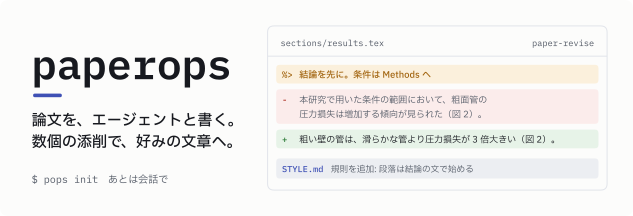

<picture>
  <source media="(prefers-color-scheme: dark)" srcset="https://raw.githubusercontent.com/Nkzono99/paperops/main/.github/assets/hero-dark.svg">
  
</picture>

<p>
  <a href="https://pypi.org/project/paper-harness-cli/"></a>
  <a href="https://pypi.org/project/paper-harness-cli/"></a>
  <a href="https://github.com/Nkzono99/paperops/actions/workflows/ci.yml"></a>
</p>

paperops は、AI エージェントと論文を 1 本書くためのツールです。エージェントが主張の設計から
図・本文・PDF までを作り、著者は主張の承認と数個の添削で方向を決めます。添削から読み取った好みは
規則として残り、次の草稿と次の論文に効きます。人が打つコマンドは `pops init` だけです。

## 会話から草稿まで

<picture>
  <source media="(prefers-color-scheme: dark)" srcset="https://raw.githubusercontent.com/Nkzono99/paperops/main/.github/assets/conversation-dark.svg">
  
</picture>

## はじめる

```bash
uv tool install paper-harness-cli
pops init paper-rough-pipe --source ~/work/project_pipe_flow
cd paper-rough-pipe
```

`--source` は結果の出どころで、runops project の root などを指します。複数書け、後から足すこともできます。
できた directory で Codex か Claude Code を起動して、書きたい論文について話しかけてください。
英語で書き始めるときは `--lang en` を付けます。

## 頼めること

| やりたいこと | 頼み方の例 |
|---|---|
| 主張を決める | project_pipe_flow の結果で論文を書きたい。主張の候補を出して |
| 通して書かせる | 案 A で進めて。図と本文を最後まで作って、PDF を見せて |
| 結果が無い所も書かせる | 粗さ 2% の計算はまだ無いが、壁の応力で説明できるはず。予想で最後まで書いて、要る計算を並べて |
| 答え合わせをする | roughness-scan の再計算が終わった。予想と比べて、原稿に反映して |
| 骨子を見る | 各段落の第 1 文だけ並べて見せて |
| 図を直す | 図 2 は主役の線が埋もれている。直して、他の図も同じ基準で見直して |
| 添削を反映する | `%>` でコメントを入れた。反映して、好みは STYLE に残して |
| 節の詳しさを決める | 圧力損失の節は、粗さが効いたと読者が見分けられれば十分。各条件の値は表に任せて |
| 伝わるか確かめる | 初見の読者に読ませて、何を言う論文に見えるか確かめて |
| PDF だけを講評させる | この PDF だけ読んで、説明が詳しすぎる箇所と、残すべき根拠を挙げて |
| 英語版を作る | 日本語稿が固まったので英語版を作って |
| 更新する | paperops を最新にして |

著者の手間は、主張の承認、図の確認、草稿への添削の 3 か所に集まります。主張・発見・載せないものを決めるときと、
それを変えるときは、エージェントが案を示して確認を取ります。ほかに著者の判断が要る点は、`BRIEF.md` の
「未決」に `- [ ]` で並び、決着すると `- [x]` になります。残りは次の session のエージェントにも引き継がれます。

## 添削のしかた

TeX に `%>` で始まるコメントを書きます。段落の上に書くとその段落全体に、行末に書くとその文に付きます。
会話で伝えても同じです。

```tex
%> 結論を先に。条件は Methods へ
本研究で用いた条件の範囲において、粗面管の圧力損失は増加する傾向が見られた（図 2）。
```

エージェントは指摘箇所を直し、同じ好みが当てはまる他の箇所にも広げ、好みを規則として STYLE に残します。
何を学んだかは毎回報告されるので、違っていれば「その規則は違う」と伝えてください。

「この節の改稿から、次の論文にも使えることを拾って」と頼むこともできます。
著者が直接書き換えた文や、講評を受けて採用・撤回した変更をたどり、どんな場面で同じ判断が役立つかを差分とともに返します。
STYLE の「候補」「共有待ち」も手掛かりになります。実際の添削から、比較の組み方や図注の判断を取り出した
[具体例](docs/lessons-from-style.md)があります。

エージェントが原稿を直している間に自分でも書き込むときは、任意の VS Code 拡張
[Paperops Review](https://github.com/Nkzono99/paperops/tree/main/vscode/paperops-review) を使えます。
添削用のタブに書いた本文や `%>` とエージェントの修正が自動で統合され、同じ箇所が重なったときだけ両案が
表示されます。導入と使い方は拡張の README にあります。

## 結果が揃う前に、流れを見る

結果がまだ無い所は、エージェントが根拠のある予想で先に書きます。予想の結果、その解釈、論文にとっての意味まで
完成形の文で書かれるので、計算を回す前に論文全体の流れを確かめられます。

```tex
% 予想: 粗さに比例するとした見積もり（BRIEF C2）。roughness-scan の再計算で置き換える
\newcommand{\stressRatio}{\pred{2.8}}
```

- 予想は PDF で色が付き、`BRIEF.md` の発見と図にも状態（`予想`、`predicted`）が残ります。
- 予想するのは、これから得る結果だけです。実行済みの run、手元の data、文献の内容は、確かめたことを書きます。
- 手間は、結果次第で主張が覆る所に使います。外れたら驚くような予想は理由 1 行で進め、どちらに転ぶか
  分からず主張が変わる予想（賭け）にだけ、当たりの基準と外れた場合を書いて先に確かめます。
- 結果が出たら答え合わせをします。当たれば印を外し、賭けが外れたら主張と発見を直す案が示されます。

## 発表までに要る計算を絞る

主張を支える証拠が揃ったら、検証を足すより発表を優先します。`BRIEF.md` の「これから要る計算」には
発表までに要るものだけが載るので、この表が、発表を止めているものの一覧になります。いつ発表するかは著者が決めます。

- 表に載るのは、主張と発見が使う結果を得る計算と、賭けを確かめる計算です。いまの simulator で得られるかと
  費用の見当が添えられます。
- 確認済みの結果に上乗せする検証（収束、感度、条件の拡張）は、当たれば主張が覆る疑いに絞ります。
  範囲を変えるだけの疑いは、行った計算の範囲を成立条件として書いて済ませます。行わないと決めた検証は、
  理由つきで表の下に残ります。
- 主計算の設定を既知解で確かめる必要があるときは、対照を主計算の前に置き、何がどこまで一致すればよいかを
  先に決めます。
- 記述を読みやすくするためだけの計算（比較条件をそろえて断り書きを減らす、など）は、消せる文と費用を添えた
  任意の案として示され、表には入りません。既存の出力で直せる箇所は、計算を足さずに直します。

## project の中身

```text
paper-rough-pipe/
├── paper.toml              source・言語・build の設定
├── BRIEF.md                何を言う論文か（主張 1 文、発見、載せないもの、段落骨子）
├── STYLE.md                添削から学んだ、この論文での書き方
├── manuscript/
│   ├── main.tex
│   ├── sections/
│   ├── numbers.tex         本文に出す数値と出典
│   └── refs.bib
├── figures/
│   ├── paper.mplstyle      全ての図に共通の見た目
│   └── pressure-loss/
│       ├── figure.md       図の設計（メッセージ、載せないもの）と推敲の記録
│       ├── make.py
│       └── pressure-loss.pdf
├── LOG.md                  決めたことと理由
├── build/                  PDF
└── AGENTS.md, .agents/skills/, .claude/skills/
```

- 論文をまたいで使う著者の好みは `~/.config/paperops/STYLE.md` に溜まります
  （`pops init --style FILE` で場所を変えられます）。
- 執筆の履歴は Git に残ります。エージェントは、履歴のない論文では編集前の状態を記録し、以後は草稿や添削が
  一区切りするたびにローカルで commit します。著者や利用先の Git 方針があればそれを優先し、push と release は
  依頼されたときに行います。`build/` は Git の対象外です。

## 何を言う論文かが伝わるように

エージェントに任せた原稿は、結果を正確に並べただけで、何を言いたいのかが見えなくなりがちです。
paperops は次の順で進めて、それを防ぎます。

| 段階 | すること |
|---|---|
| 書く前 | `BRIEF.md` に主張 1 文と「載せないもの」を決め、著者が承認する。結果やモデルで取捨が分かれる節には、段落骨子に「読者が何を判断できたら説明を終えるか」を一行添える |
| 書くとき | 主張の文は言い切り、主張を支える根拠を前に出す。成立条件と限界は決めた置き場に一度だけ書き、数値の出典は `numbers.tex` が持つ。まだ無い結果は予想で書いて印を付ける |
| 図 | 描く前に `figure.md` へメッセージ 1 文と「載せないもの」を決める。掲載寸法の描画結果を見て直し、設計を知らない別のエージェントに画像だけを見せて、読み取った内容と使わなかった要素を確かめる |
| 書いた後 | 主張を知らない別のエージェントに PDF だけを読ませ、受け取った主張と、どこで判断が済んだかを `BRIEF.md` と比べる。数値は議論・限界に出るものまで出どころの run と集計方法をたどり、用語と記号は本文・caption・図で揃える |

結果とモデルの詳しさは、読者にしてほしい判断で決めます。たとえば改善の要因を示す節なら、中間の対照は本文に残し、
各条件の値を引くには表が、条件を変えたときの傾向を比べるには図が使えます。決め方は
[執筆の手引き](https://github.com/Nkzono99/paperops/blob/main/src/paperops/skills/paper-draft/references/results-and-model.md)に、
そのもとにした原著 12 本の読解は
[読解の記録](https://github.com/Nkzono99/paperops/blob/main/docs/results-and-model-readings.md)にあります。

## 1.x から移る

2.0 は作り直しで、1.x の `_paperops/` や `pops change` などはありません。1.x の project は
`paper-harness-cli==1.0.0` のまま使えます。移すときは、新しい directory で `pops init` し、原稿の TeX と図を
`manuscript/` と `figures/` に置いてから、「既存の原稿から BRIEF を起こして」と頼んでください。

---

[SPEC](https://github.com/Nkzono99/paperops/blob/main/SPEC.md) ·
[変更履歴](https://github.com/Nkzono99/paperops/blob/main/CHANGELOG.md) ·
[開発に参加する](https://github.com/Nkzono99/paperops/blob/main/AGENTS.md)
