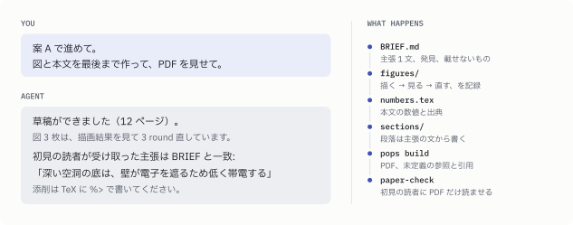

<picture>
  <source media="(prefers-color-scheme: dark)" srcset="https://raw.githubusercontent.com/Nkzono99/paperops/main/.github/assets/hero-dark.svg">
   コメント「結論を先に。条件は Methods へ」に従って文が書き換えられ、STYLE.md に規則「段落は結論の文で始める」が追加されている。" src="https://raw.githubusercontent.com/Nkzono99/paperops/main/.github/assets/hero-light.svg" width="100%">
</picture>

<p>
  <a href="https://pypi.org/project/paper-harness-cli/"></a>
  <a href="https://pypi.org/project/paper-harness-cli/"></a>
  <a href="https://github.com/Nkzono99/paperops/actions/workflows/ci.yml"></a>
</p>

paperops は、AI エージェントと論文を 1 本書くためのツールです。エージェントが主張の設計から
図・本文・PDF までを作り、著者は主張の承認と数個の添削で方向を決めます。添削から読み取った好みは
規則として残り、次の草稿と次の論文に効きます。人が打つコマンドは `pops init` だけです。

## 会話から草稿まで

<picture>
  <source media="(prefers-color-scheme: dark)" srcset="https://raw.githubusercontent.com/Nkzono99/paperops/main/.github/assets/conversation-dark.svg">
  
</picture>

## はじめる

```bash
uv tool install paper-harness-cli
pops init paper-rough-pipe --source ~/work/project_pipe_flow
cd paper-rough-pipe
```

`--source` は結果の出どころで、runops project の root などを指します。複数書け、後から足すこともできます。
できた directory で Codex か Claude Code を起動して、書きたい論文について話しかけてください。
英語で書き始めるときは `--lang en` を付けます。

## 頼めること

| やりたいこと | 頼み方の例 |
|---|---|
| 主張を決める | project_pipe_flow の結果で論文を書きたい。主張の候補を出して |
| 通して書かせる | 案 A で進めて。図と本文を最後まで作って、PDF を見せて |
| 結果が無い所も書かせる | 粗さ 2% の計算はまだ無いが、壁の応力で説明できるはず。予想で最後まで書いて、要る計算を並べて |
| 答え合わせをする | roughness-scan の再計算が終わった。予想と比べて、原稿に反映して |
| 骨子を見る | 各段落の第 1 文だけ並べて見せて |
| 図を直す | 図 2 は主役の線が埋もれている。直して、他の図も同じ基準で見直して |
| 添削を反映する | `%>` でコメントを入れた。反映して、好みは STYLE に残して |
| 伝わるか確かめる | 初見の読者に読ませて、何を言う論文に見えるか確かめて |
| 英語版を作る | 日本語稿が固まったので英語版を作って |
| 更新する | paperops を最新にして |

主張・発見・載せないものを決めるときと、それを変えるときは、エージェントが案を示して確認を取ります。

## 添削のしかた

TeX に `%>` で始まるコメントを書きます。段落の上に書くとその段落全体に、行末に書くとその文に付きます。
会話で伝えても同じです。

```tex
%> 結論を先に。条件は Methods へ
本研究で用いた条件の範囲において、粗面管の圧力損失は増加する傾向が見られた（図 2）。
```

エージェントは指摘箇所を直し、同じ好みが当てはまる他の箇所にも広げ、好みを規則として STYLE に残します。
何を学んだかは毎回報告されるので、違っていれば「その規則は違う」と伝えてください。

## 結果が揃う前に、流れを見る

結果がまだ無い所は、エージェントが根拠のある予想で先に書きます。予想の結果、その解釈、論文にとっての意味まで
完成形の文で書かれるので、計算を回す前に論文全体の流れを確かめられます。

```tex
% 予想: 粗さに比例するとした見積もり（BRIEF C2）。roughness-scan の再計算で置き換える
\newcommand{\stressRatio}{\pred{2.8}}
```

- 予想は PDF で色が付き、`BRIEF.md` の発見と図にも状態（`予想`、`predicted`）が残ります。
- 予想ごとに、根拠、いまの simulator で得られるかの見積もり、何が出れば当たりか、外れたら論文がどう変わるかを
  `BRIEF.md` に書きます。主張が予想に依っているときは、外れても言える主張も添えられます。
- 検証は、主張への影響が大きく、確信度が低く、費用が小さいものから順に並びます。
- 予想するのは、これから得る結果だけです。実行済みの run、手元の data、文献の内容は、確かめたことを書きます。
- 結果が出たら答え合わせをします。当たれば印を外し、外れたら主張と発見を直す案が示されます。

## project の中身

```text
paper-rough-pipe/
├── paper.toml              source・言語・build の設定
├── BRIEF.md                何を言う論文か（主張 1 文、発見、載せないもの、段落骨子）
├── STYLE.md                添削から学んだ、この論文での書き方
├── manuscript/
│   ├── main.tex
│   ├── sections/
│   ├── numbers.tex         本文に出す数値と出典
│   └── refs.bib
├── figures/
│   ├── paper.mplstyle      全ての図に共通の見た目
│   └── pressure-loss/
│       ├── figure.md       図のメッセージと推敲の記録
│       ├── make.py
│       └── pressure-loss.pdf
├── LOG.md                  決めたことと理由
├── build/                  PDF
└── AGENTS.md, .agents/skills/, .claude/skills/
```

`build/` は Git の対象外です。論文をまたいで使う著者の好みは `~/.config/paperops/STYLE.md` に溜まります
（`pops init --style FILE` で場所を変えられます）。

## 何を言う論文かが伝わるように

エージェントに任せた原稿は、結果を正確に並べただけで、何を言いたいのかが見えなくなりがちです。
paperops は次の順で進めて、それを防ぎます。

| 段階 | すること |
|---|---|
| 書く前 | `BRIEF.md` に主張 1 文と「載せないもの」を決め、著者が承認する |
| 書くとき | 主張の文は言い切る。成立条件は決めた置き場に一度だけ書き、数値の出典は `numbers.tex` が持つ。まだ無い結果は予想で書いて印を付ける |
| 図 | 掲載寸法の描画結果を見て直す round を回し、`figure.md` に記録する |
| 書いた後 | 主張を知らない別のエージェントに PDF だけを読ませ、受け取った主張を `BRIEF.md` と比べる |

## 1.x から移る

2.0 は作り直しで、1.x の `_paperops/` や `pops change` などはありません。1.x の project は
`paper-harness-cli==1.0.0` のまま使えます。移すときは、新しい directory で `pops init` し、原稿の TeX と図を
`manuscript/` と `figures/` に置いてから、「既存の原稿から BRIEF を起こして」と頼んでください。

---

[SPEC](https://github.com/Nkzono99/paperops/blob/main/SPEC.md) ·
[変更履歴](https://github.com/Nkzono99/paperops/blob/main/CHANGELOG.md) ·
[開発に参加する](https://github.com/Nkzono99/paperops/blob/main/AGENTS.md)
