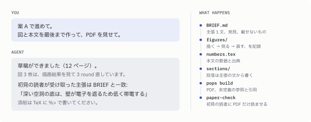

<picture>
  <source media="(prefers-color-scheme: dark)" srcset="https://raw.githubusercontent.com/Nkzono99/paperops/main/.github/assets/hero-dark.svg">
  
</picture>

<p>
  <a href="https://pypi.org/project/paper-harness-cli/"></a>
  <a href="https://pypi.org/project/paper-harness-cli/"></a>
  <a href="https://github.com/Nkzono99/paperops/actions/workflows/ci.yml"></a>
</p>

paperops は、AI エージェントと論文を 1 本書くためのツールです。エージェントが主張の設計から
図・本文・PDF までを作り、著者は主張の承認と数個の添削で方向を決めます。添削から読み取った好みは
規則として残り、次の草稿と次の論文に効きます。人が打つコマンドは `pops init` だけです。

## 会話から草稿まで

<picture>
  <source media="(prefers-color-scheme: dark)" srcset="https://raw.githubusercontent.com/Nkzono99/paperops/main/.github/assets/conversation-dark.svg">
  
</picture>

## はじめる

```bash
uv tool install paper-harness-cli
pops init paper-rough-pipe --source ~/work/project_pipe_flow
cd paper-rough-pipe
```

できた directory で Codex や Claude Code などのエージェントを起動し、書きたい論文について話しかけてください。

- `--source`: 結果の出どころ（runops project の root など）。複数指定や後から追加もできます。
- `--lang en`: 英語で書き始めるときに付けます。
- `--track progress`: 投稿前の進捗を論文の形でまとめる区分です。推奨案はエージェントが反映して報告します。既定の `submission` では、主張に関わる変更は著者が決めます（`paper.toml` で変更可）。

## 頼めること

著者の手間は、**主張の承認**、**図の確認**、**草稿への添削**の 3 か所に集まります。

| やりたいこと | 頼み方の例 |
|---|---|
| 主張を決める | project_pipe_flow の結果で論文を書きたい。主張の候補を出して |
| 通して書かせる | 案 A で進めて。図と本文を最後まで作って、PDF を見せて |
| 結果が無い所を予想で書く | 粗さ 2% の計算はまだ無いが、予想で最後まで書いて、要る計算を並べて |
| 答え合わせをする | roughness-scan の再計算が終わった。予想と比べて、原稿に反映して |
| 骨子を見る | 各段落の第 1 文だけ並べて見せて |
| 図を直す | 図 2 は主役の線が埋もれている。直して、他の図も同じ基準で見直して |
| 添削を反映する | `%>` でコメントを入れた。反映して、好みは STYLE に残して |
| 伝わるか確かめる | 初見の読者に読ませて、何を言う論文に見えるか確かめて |
| レビューさせる | この PDF をレビューして。通すのに必要な点と、良くする案を分けて |
| 公開データを用意する | 図を再現できるデータを Zenodo 向けにまとめて |
| 英語版を作る・更新する | 日本語稿が固まったので英語版を作って ／ paperops を最新にして |

## 仕組み

エージェントに任せた原稿は、結果を同じ重みで並べて主張が見えなくなったり、追加の検証が際限なく増えたりしがちです。
paperops は次の 4 つで防ぎます（詳細は [SPEC](https://github.com/Nkzono99/paperops/blob/main/SPEC.md)）。

| 段階 | すること |
|---|---|
| **主張を固定する** | 書く前に `BRIEF.md` で主張 1 文・主要な発見・「載せないもの」・段落骨子を決め、著者が承認します。 |
| **予想で先に書き、計算を絞る** | 未取得の結果は根拠つきで `\pred{}` の印を付けて完成形で書き、流れを先に確かめます。証拠が揃ったら、主張を覆しうる検証だけを「これから要る計算」に残して発表を優先します。 |
| **図を設計し、見て直す** | 描く前に `figure.md` でメッセージ 1 文と載せないものを決め、掲載寸法の描画結果と初見の読者の読み取りで推敲します。 |
| **初見の読者で確かめる** | 主張を知らない別のエージェントに PDF だけを読ませて `BRIEF.md` と比べ、数値・出典・記号を照合します。講評では「通すのに必要な点」と「良くする案」を分けて終わらせます。 |

## 添削のしかた

TeX に `%>` で始まるコメントを書きます。段落の上に書くとその段落全体に、行末に書くとその文に付きます（会話で伝えても同じです）。

```tex
%> 結論を先に。条件は Methods へ
本研究で用いた条件の範囲において、粗面管の圧力損失は増加する傾向が見られた（図 2）。
```

エージェントは指摘箇所を直したうえで、同じ好みを原稿全体へ広げ、規則として `STYLE.md`（論文をまたぐ好みは共有 STYLE）に残します。学んだ規則は毎回報告されるので、違っていれば「その規則は違う」と直せます。

- **並行して添削する（任意）**: エージェントの修正中に自分でも書き込むときは、VS Code 拡張 [Paperops Review](https://github.com/Nkzono99/paperops/tree/main/vscode/paperops-review) を使うと変更を 3 方向マージできます。
- **改稿から学ぶ**: 「この節の改稿から次の論文にも使えることを拾って」と頼むと、直接の書き換えや講評の採否から再利用できる判断を抽出します。

## project の中身

```text
paper-rough-pipe/
├── paper.toml              論文の区分・source・言語・build の設定
├── BRIEF.md                何を言う論文か（主張 1 文、発見、載せないもの、段落骨子、未決）
├── STYLE.md                添削から学んだ、この論文での書き方
├── manuscript/
│   ├── main.tex
│   ├── sections/
│   ├── numbers.tex         本文に出す数値と出典
│   └── refs.bib
├── figures/
│   ├── paper.mplstyle      全ての図に共通の見た目
│   └── pressure-loss/
│       ├── figure.md       図の設計（メッセージ、載せないもの）と推敲の記録
│       ├── make.py
│       └── pressure-loss.pdf
├── LOG.md                  決めたことと理由
├── build/                  PDF（Git の対象外）
└── AGENTS.md, .agents/skills/, .claude/skills/
```

- **共有 STYLE**: 論文をまたぐ好みは `~/.config/paperops/STYLE.md` に溜まります（`pops init --style FILE` で変更可）。
- **Git 履歴**: 草稿や添削の区切りごとにローカルで commit します（push・release は依頼時のみ）。

## 1.x から移る

2.0 は作り直しで、1.x の `_paperops/` や `pops change` などはありません。1.x の project は `paper-harness-cli==1.0.0` のまま使えます。
移すときは、新しい directory で `pops init` し、原稿の TeX と図を `manuscript/` と `figures/` に置いてから、「既存の原稿から BRIEF を起こして」と頼んでください。

## 詳しく見る

- **設計と開発**: [SPEC](https://github.com/Nkzono99/paperops/blob/main/SPEC.md) · [変更履歴](https://github.com/Nkzono99/paperops/blob/main/CHANGELOG.md) · [開発に参加する](https://github.com/Nkzono99/paperops/blob/main/AGENTS.md)
- **手引き**: [結果とモデル説明](https://github.com/Nkzono99/paperops/blob/main/src/paperops/skills/paper-draft/references/results-and-model.md) · [図の公開データ（Zenodo 等）](https://github.com/Nkzono99/paperops/blob/main/src/paperops/skills/paper-figure/references/open-data.md) · [Paperops Review（VS Code 拡張）](https://github.com/Nkzono99/paperops/tree/main/vscode/paperops-review)
- **背景と記録**: [原著 12 本の読解](https://github.com/Nkzono99/paperops/blob/main/docs/results-and-model-readings.md) · [添削からの具体例](https://github.com/Nkzono99/paperops/blob/main/docs/lessons-from-style.md) · [講評をどこで終えるか](https://github.com/Nkzono99/paperops/blob/main/docs/review-baseline.md)
